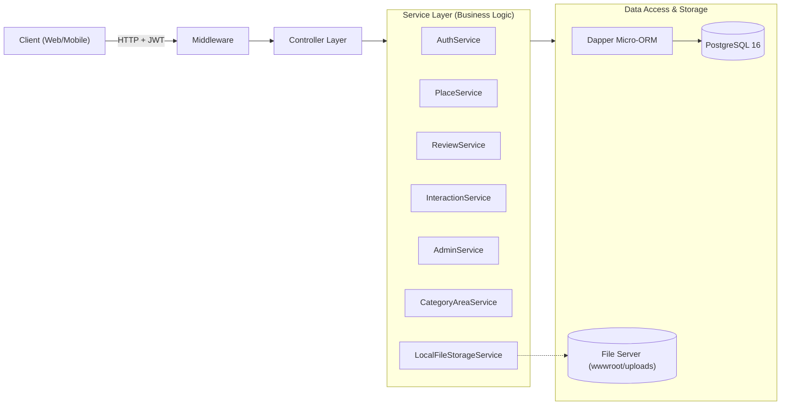
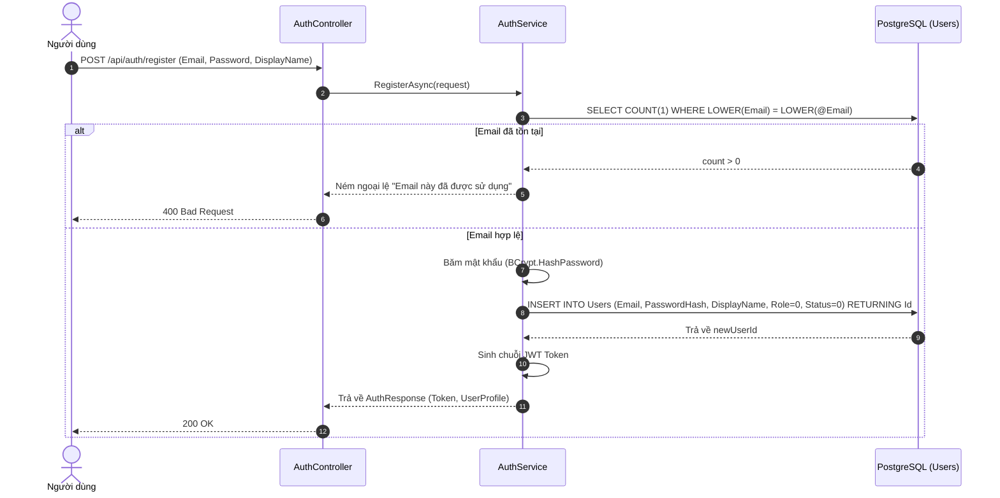
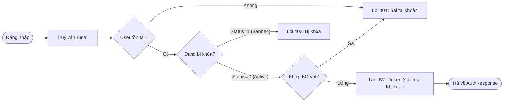
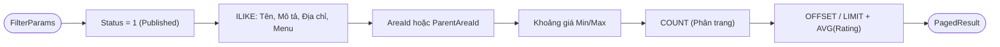
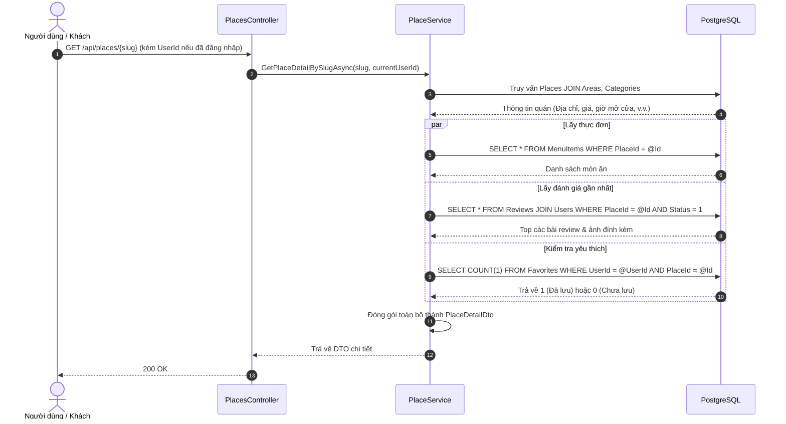
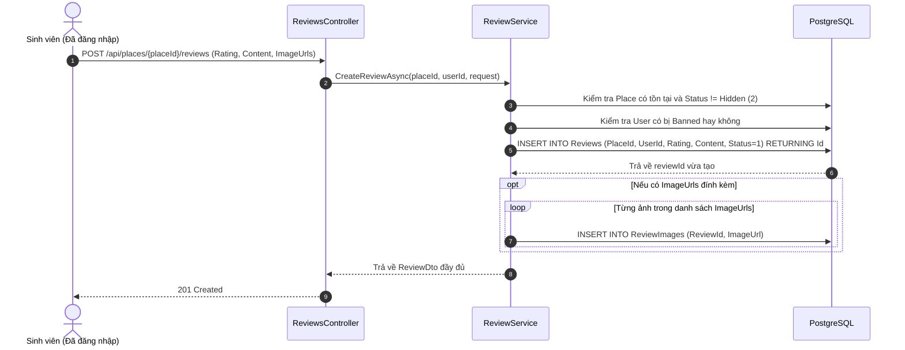
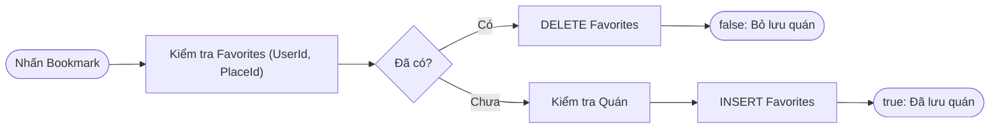
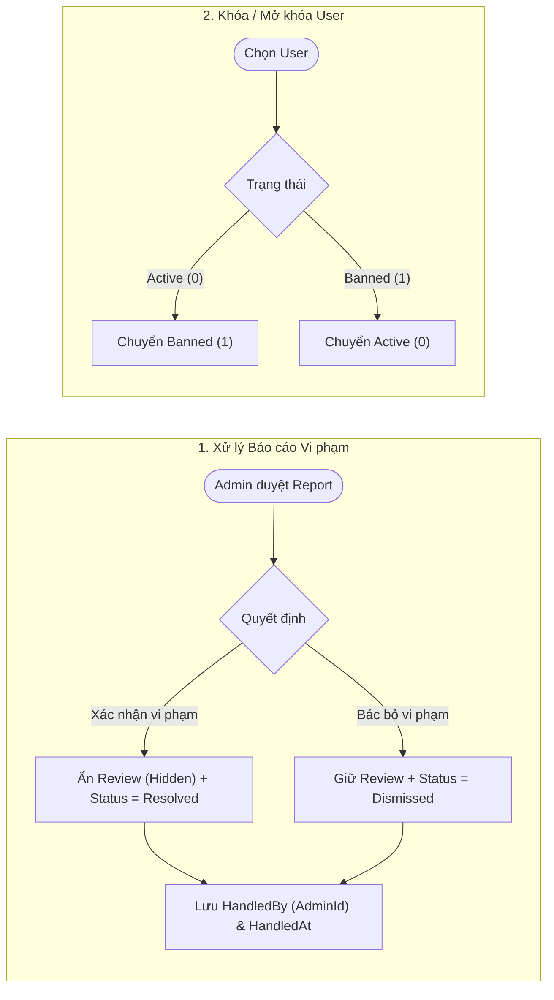

# TÀI LIỆU LUỒNG HOẠT ĐỘNG TOÀN BỘ SERVICES & CHỨC NĂNG
## DỰ ÁN: FOOD REVIEW - LÀNG ĐẠI HỌC (ĐHQG TP.HCM)

---

## 1. TỔNG QUAN KIẾN TRÚC & PHÂN TẦNG (ARCHITECTURE OVERVIEW)

Hệ thống backend được xây dựng theo kiến trúc phân tầng (Clean Layered Architecture) trên nền tảng .NET 9 Web API và Dapper Micro-ORM kết nối cơ sở dữ liệu PostgreSQL.

---

## 2. LUỒNG XÁC THỰC & HỒ SƠ NGƯỜI DÙNG (`AuthService`)

### 2.1. Đăng ký tài khoản (`RegisterAsync`)
1. Client gửi thông tin: `Email`, `Password`, `DisplayName`.
2. Hệ thống kiểm tra trùng lặp email không phân biệt chữ hoa/thường (`LOWER(Email)`).
3. Mật khẩu được băm an toàn bằng thuật toán `BCrypt`.
4. Ghi bản ghi vào bảng `Users` với quyền mặc định `Role = User (0)`, trạng thái `Status = Active (0)`.
5. Sinh mã thông báo JWT trả về cùng thông tin người dùng.

### 2.2. Đăng nhập hệ thống (`LoginAsync`)

---

## 3. LUỒNG KHÁM PHÁ & QUẢN LÝ QUÁN ĂN (`PlaceService`)

### 3.1. Tìm kiếm và Bộ lọc động (`GetPlacesAsync`)
* **Tìm kiếm theo từ khóa (`Search`):** So khớp không phân biệt hoa thường (`ILIKE`) với tên quán, mô tả, địa chỉ và cả các món có trong menu thông qua `EXISTS (SELECT 1 FROM MenuItems)`.
* **Lọc theo khu vực (`AreaId`):** Bao gồm cả quán nằm tại khu vực được chọn và các khu vực con của nó (`p.AreaId = @AreaId OR a.ParentAreaId = @AreaId`).
* **Lọc theo khoảng giá:** Đối chiếu `PriceMax >= MinPrice` và `PriceMin <= MaxPrice`.
* **Sắp xếp linh hoạt:** Hỗ trợ sắp xếp theo `rating` (đánh giá sao giảm dần), `reviews` (lượng review nhiều nhất), `newest` (mới nhất), hoặc mặc định tên A-Z.

### 3.2. Xem chi tiết quán ăn (`GetPlaceDetailAsync` / `GetPlaceDetailBySlugAsync`)

---

## 4. LUỒNG ĐÁNH GIÁ & TẢI ẢNH (`ReviewService` & `LocalFileStorageService`)

### 4.1. Tải tệp hình ảnh (`LocalFileStorageService.SaveFileAsync`)
* **Kiểm tra an toàn:** Dung lượng tối đa không quá 5MB. Định dạng hợp lệ gồm `.jpg`, `.jpeg`, `.png`, `.webp`.
* **Lưu trữ:** Tạo tên file độc nhất bằng `Guid.NewGuid()`, ghi file vào đường dẫn vật lý `wwwroot/uploads/{subFolder}` và trả về URL tương đối `/uploads/{subFolder}/{fileName}`.

### 4.2. Đăng bài đánh giá (`ReviewService.CreateReviewAsync`)

---

## 5. LUỒNG TƯƠNG TÁC NGƯỜI DÙNG (`InteractionService`)

### 5.1. Bật/Tắt quán yêu thích (`ToggleFavoriteAsync`)

### 5.2. Báo cáo vi phạm đánh giá (`ReportReviewAsync`)
1. Sinh viên phát hiện bài review chứa nội dung phản cảm, quảng cáo spam hoặc sai sự thật.
2. Gửi yêu cầu gồm: `ReviewId`, `Reason` (0: Spam, 1: Inappropriate, 2: Misleading, 3: Other) và `Description`.
3. Hệ thống kiểm tra bài review có tồn tại, sau đó thêm bản ghi vào bảng `Reports` với trạng thái ban đầu `Status = Pending (0)`.

---

## 6. LUỒNG QUẢN TRỊ & KIỂM DUYỆT (`AdminService`)

Dành riêng cho tài khoản có quyền `Role = Admin (1)`.

---

## 7. BẢNG TỔNG HỢP MÃ LỖI & MÃ PHẢN HỒI (HTTP STATUS CODES)

| Tình huống nghiệp vụ | HTTP Code | Ngoại lệ ném ra | Mô tả |
| :--- | :--- | :--- | :--- |
| Đăng ký trùng email | `400 Bad Request` | `InvalidOperationException` | Email đã có tài khoản sử dụng. |
| Đăng nhập sai mật khẩu / tài khoản | `401 Unauthorized` | `UnauthorizedAccessException` | Sai thông tin xác thực. |
| Tài khoản bị khóa (Banned) | `403 Forbidden` | `UnauthorizedAccessException` | Bị chặn thao tác đăng bài, review. |
| Không tìm thấy quán ăn / review | `404 Not Found` | `KeyNotFoundException` | Id hoặc Slug không tồn tại trong hệ thống. |
| Upload file sai định dạng hoặc > 5MB | `400 Bad Request` | `InvalidOperationException` | Vi phạm chính sách an toàn file. |
| Sửa/Xóa review của người khác | `403 Forbidden` | `UnauthorizedAccessException` | Không phải chính chủ của bài viết. |

